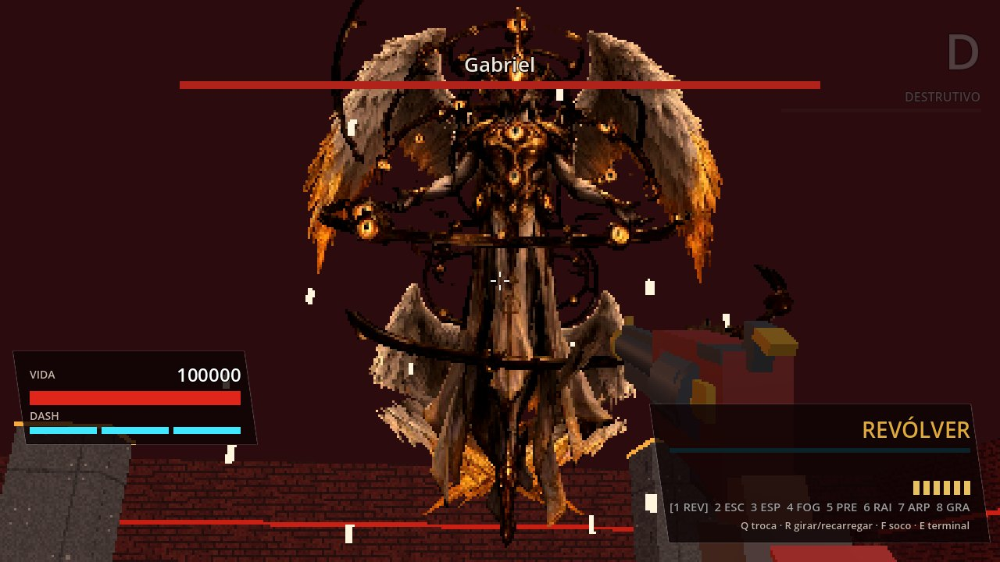
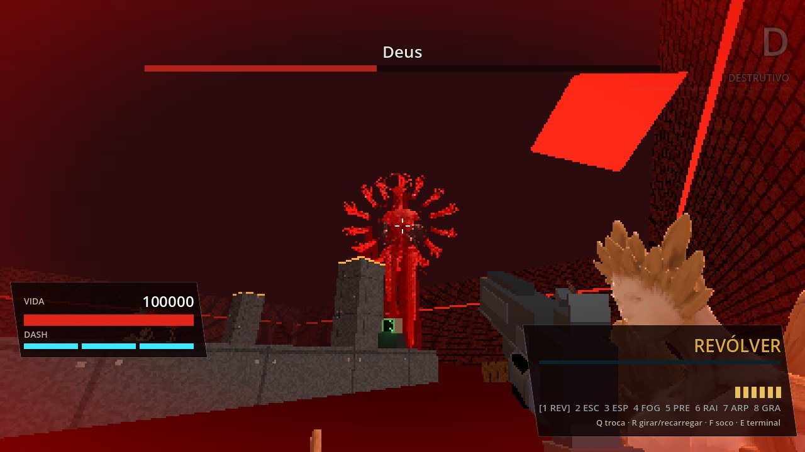
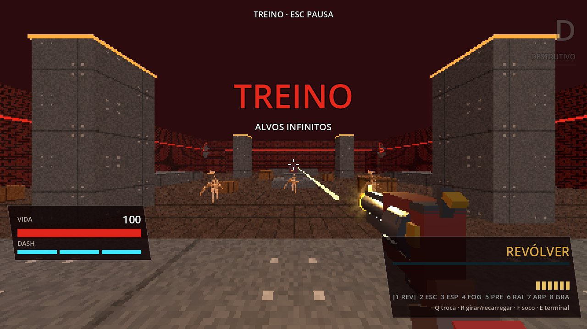

<div align="center">

# DEICIDE

**FPS de arena frenético no estilo ULTRAKILL — mate os anjos, depois mate Deus.**


</div>

---

## Sobre

*Deicide* é um jogo de tiro em primeira pessoa rápido e violento, feito inteiro em **Godot 4.7** com GDScript.
Você corre, desliza, dá dash, pula nas paredes, gira as armas e devolve projéteis no soco enquanto enfrenta
ondas de servas aladas, o arcanjo **Gabriel** e, por fim, o próprio **Deus**.

O sangue dos inimigos cura você — quanto mais perto e mais agressivo, mais você sobrevive.
Um ranking de heresia (de Devoto a Supremo Sacrilégio) recompensa variar as armas, acertar na cabeça e aparar ataques, e enche a barra de **Blasfêmia**: cheia, ela para o tempo e executa com raios todos os anjos na tela.

| | |
|---|---|
|  |  |
| **Gabriel**, o Arauto de Muitos Olhos | **Deus** na segunda fase: a arena inundada de sangue |
|  |  |
| A **Ceifadora**, com esqueleto animado por código | A arma principal: gira, ricocheteia e recarrega |

## Como jogar

1. Baixe o **[Godot 4.7](https://godotengine.org/download)** (versão padrão, não precisa da .NET).
2. Clone ou baixe este repositório:
   ```bash
   git clone https://github.com/DanteSL/Deicide.git
   ```
3. Abra o Godot → **Importar** → escolha o arquivo `project.godot`.
4. Na primeira abertura o Godot importa modelos e sons (alguns segundos).
5. Aperte **F5**.

## Modos

| Modo | Descrição |
|---|---|
| **Ondas** | Hordas crescentes. A cada 5 ondas aparece Gabriel; a cada 10, Deus. |
| **Treino** | Alvos infinitos para testar armas e melhorias. |
| **Gabriel** | Luta direta contra o arcanjo (8 ataques, segunda fase). |
| **Deus** | Luta direta contra Deus (10 ataques, segunda fase com a arena inundada). |

## Controles

| Ação | Tecla |
|---|---|
| Mover | **W A S D** |
| Pular / pulo na parede | **Espaço** |
| Dash (3 cargas, invencível) | **Shift** |
| Deslizar / pisão no ar | **C** |
| Atirar | **Clique esquerdo** |
| Especial da arma | **Clique direito** |
| Trocar arma | **Q** (anterior) · **1–8** · **roda do mouse** |
| Girar / recarregar | **R** |
| Soco e rebater projéteis | **F** |
| Blasfêmia (com a barra cheia) | **G** |
| Terminal de arsenal (perto dele) | **E** |
| Pausar / configurações | **ESC** |

No menu de pausa dá para ajustar sensibilidade, campo de visão, volume geral, volume da música
e o visual retrô pixelado. Tudo fica salvo.

## Documentação

| Documento | Conteúdo |
|---|---|
| [Jogabilidade](docs/JOGABILIDADE.md) | Movimento, estilo, cura com sangue, aparar projéteis |
| [Armas](docs/ARMAS.md) | As 8 armas, botão direito de cada uma e as 24 melhorias |
| [Inimigos e chefes](docs/INIMIGOS.md) | Servas, brutamontes, drones, Gabriel e Deus — todos os ataques |
| [Arquitetura](docs/ARQUITETURA.md) | Como o código está organizado, como adicionar armas e inimigos, testes |
| [Histórico de mudanças](CHANGELOG.md) | O que foi feito em cada etapa |

## Estrutura do projeto

```
Deicide/
├── project.godot          # configuração do projeto Godot
├── main.tscn              # cena principal (tudo é montado por código)
├── scripts/
│   ├── g.gd               # autoload: estado global, sons, partículas, dano, salvamento
│   ├── main.gd            # arena, HUD, menus, ondas, projéteis, terminal de arsenal
│   ├── player.gd          # movimento e câmera
│   ├── weapons.gd         # revólver, escopeta, soco e troca de armas
│   ├── extra_weapons.gd   # espadas, foguetes, pregadora, raio, arpão e granadas
│   ├── enemy.gd           # inimigos comuns
│   ├── ceifadora.gd       # esqueleto e animação procedural da Ceifadora
│   ├── gabriel.gd         # chefe Gabriel
│   └── deus.gd            # chefe Deus
├── gabriel.glb            # modelo do Gabriel (asas em duas partes, auréolas, mãos)
├── gabriel_tex.jpg        # textura do Gabriel
├── ceifadora.glb          # modelo da Ceifadora com esqueleto de 24 ossos
├── deus/                  # modelo animado de Deus, mão decepada e texturas
├── sfx/                   # efeitos sonoros e música (gerados por código)
└── docs/                  # documentação e imagens
```

## Créditos

- Estátuas do corredor da Sala do Trono: modelo **"AngelStatue"**, de Zsky.

- **"Throne of Ash and Gold"** (batalha final contra Deus): composta por DanteSL.

- Design, direção e modelos 3D de origem: **DanteSL**
- Código, animações procedurais, rigging e sons: feitos em conjunto com **Claude** (Anthropic)
- Inspiração: *ULTRAKILL* (New Blood Interactive)
