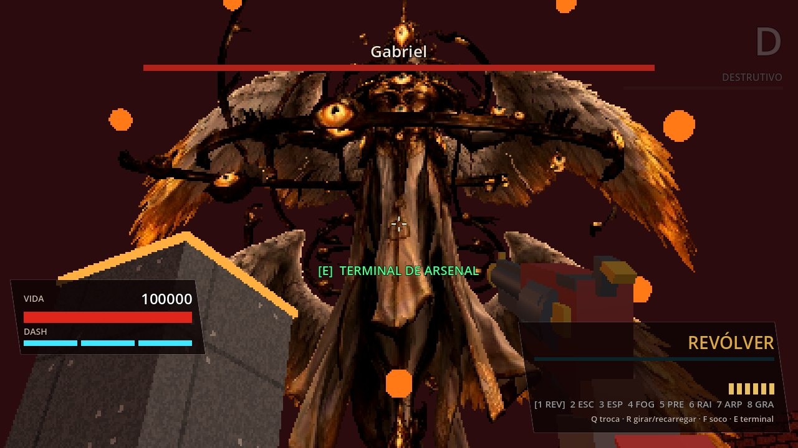
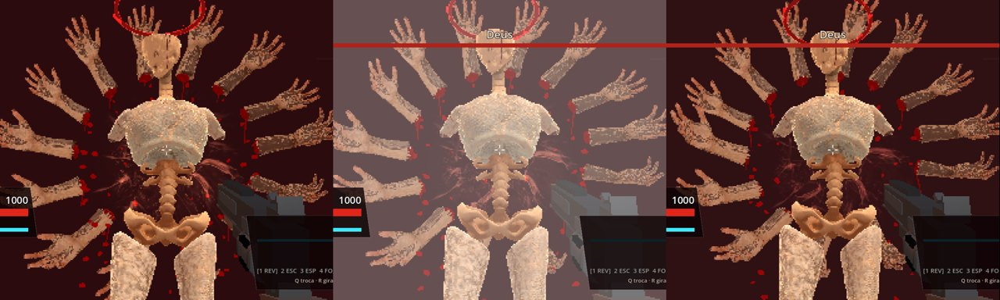
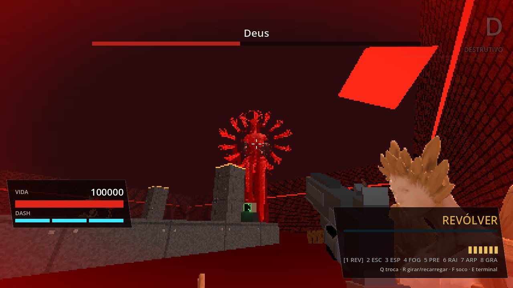

# Inimigos e chefes

## Inimigos comuns

| Inimigo | Vida | Comportamento |
|---|---|---|
| **Ceifadora** | 70 | Anjo com cajado-foice. Anda desfilando até você e só luta corpo a corpo. Fica alaranjada antes de cada golpe. |
| **Brutamonte** | 260 | Grande e lento, aguenta muito dano. Matar perto cura bastante. |
| **Drone** | 45 | Voa e dispara esferas laranja — dá para rebater com **F**. |

### Golpes da Ceifadora

A Ceifadora tem um esqueleto de 24 ossos animado por código: rebola ao andar, as asas acompanham o passo e
os braços seguram o cajado com as duas mãos (cinemática inversa).

| Golpe | Como desviar |
|---|---|
| **Corte lateral** — varre o cajado na sua frente | Recue ou dê dash para trás |
| **Golpe de cima** — ergue o cajado e bate no chão (mais forte e mais lento) | Saia para o lado |
| **Giro** — gira duas vezes acertando tudo em volta | Afaste-se |
| **Investida** — avança com uma estocada a média distância | Dash para o lado |

---

## Gabriel, o Arauto de Muitos Olhos

Aparece a cada 5 ondas ou no modo **Gabriel**. 4 200 de vida. As asas são articuladas (raiz e ponta),
dobram, se fecham e batem com o som real de asas.

| Ataque | Como desviar |
|---|---|
| **Julgamento** — raio do olho; a mira trava e pisca branco antes de disparar | Dash no momento em que pisca |
| **Tempestade de Penas** — puxa as asas para trás e solta penas das pontas | Corra de lado |
| **Lanças de Luz** — marcas no chão, lanças caem do céu | Saia das marcas |
| **Queda Celestial** — sobe, despenca no chão e solta uma onda | Pule a onda |
| **Investida** — olho vermelho, atravessa a arena voando | Dash para o lado |
| **Espada do Arcanjo** — espada de luz abre uma fenda de pilares no chão | Saia da linha |
| **Selos do Paraíso** — esferas laranja em círculo, disparadas uma a uma | Rebata com **F** |
| **Auréola Cortante** — disco gigante que vai e volta | Pule por cima |

**Segunda fase (abaixo de 50%):** "JULGAMENTO FINAL". Fica invulnerável por um instante, sobe, solta uma
explosão que empurra e passa a usar versões mais fortes dos ataques, às vezes encadeando um no outro.
Com 75%, 50% e 25% de vida chama reforços.

---

## Deus

Aparece a cada 10 ondas ou no modo **Deus**. 6 500 de vida, 32 metros de altura. Uma crista de 14 mãos
decepadas gira atrás dele, pingando sangue. **A cabeça é ponto fraco.**

| Ataque | Como desviar |
|---|---|
| **Mãos do Abismo** — mãos de osso irrompem do chão onde você pisa | Continue andando |
| **Olhar do Criador** — raio vermelho da cabeça varre o chão | Pule por cima |
| **Chuva de Sangue** — gotas caem do céu em volta de você | Rebata com **F** ou desvie |
| **Auréola do Juízo** — anéis gigantes saem dele | Pule os baixos, deslize sob os altos |
| **Dedo de Deus** — círculo persegue você e uma coluna de luz cai | Corra quando o círculo travar |
| **Punhos da Crista** — as mãos da crista voam em você e explodem | Desvie de lado |

**Segunda fase (abaixo de 50%):** "DEUS SANGRA". Ele fica vermelho-sangue e treme sem parar, cachoeiras
de sangue escorrem dos olhos e da crista e **a arena inunda**. Novos ataques:

| Ataque | Como desviar |
|---|---|
| **Convulsão** — o corpo se contorce e espirra anéis de sangue | Rebata ou passe entre as gotas |
| **Lágrimas de Sangue** — três espirais de gotas saindo dos olhos | Fique em movimento |
| **Gêiseres** — 7 gêiseres de sangue perseguem você | Mude de direção |
| **Maré de Sangue** — uma muralha atravessa a arena com uma só abertura | Corra até a abertura |

Com 70% e 35% de vida ele chama Ceifadoras.

